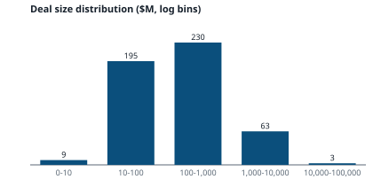
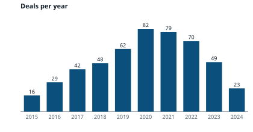
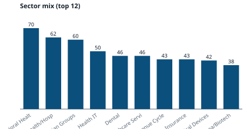
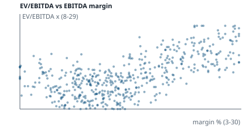

# Exploratory Data Analysis (Stage 0)

Generated by `python -m acquirer_engine --eda-only` from `ma_transactions_500.csv` (sha256 `e47a81f726f4`), for target: **Healthcare Services, ~$200M**.
This stage runs before scoring on every engine invocation. Each finding is paired with the engine's response.

## 1. Overview

- 500 deals used of 500 read (0 exact duplicates dropped), 2015–2024, 107 unique acquirers
- Missing values (% of rows): `days_to_close` 18.8%, `currency` 100.0%- Values that could not be read as numbers/dates: none- Extreme values (beyond 3x IQR): log deal size 0, EV/EBITDA 0, EV/Revenue 0

## 2. Schema mapping

| CSV column | Canonical field | Method | Confidence |
|---|---|---|---|
| `acquirer` | acquirer | exact | 1.0 |
| `target_company` | target_company | exact | 1.0 |
| `sector` | sector | exact | 1.0 |
| `deal_size_mm` | deal_size_mm | exact | 1.0 |
| `deal_year` | deal_year | exact | 1.0 |
| `ev_ebitda_multiple` | ev_ebitda_multiple | exact | 1.0 |
| `ev_revenue_multiple` | ev_revenue_multiple | exact | 1.0 |
| `outcome` | outcome | exact | 1.0 |
| `acquirer_type` | acquirer_type | exact | 1.0 |
| `geography` | geography | exact | 1.0 |
| `ebitda_margin_pct` | ebitda_margin_pct | exact | 1.0 |
| `transaction_id` | transaction_id | exact | 1.0 |
| `deal_quarter` | deal_quarter | exact | 1.0 |
| `deal_type` | deal_type | exact | 1.0 |
| `financing_type` | financing_type | exact | 1.0 |
| `target_revenue_mm` | target_revenue_mm | exact | 1.0 |
| `target_ebitda_mm` | target_ebitda_mm | exact | 1.0 |
| `revenue_growth_pct` | revenue_growth_pct | exact | 1.0 |
| `synergy_pct_of_deal` | synergy_pct_of_deal | exact | 1.0 |
| `num_bidders` | num_bidders | exact | 1.0 |
| `days_to_close` | days_to_close | exact | 1.0 |
| `strategic_rationale_tags` | strategic_rationale_tags | exact | 1.0 |
| `target_ownership_pre` | target_ownership_pre | exact | 1.0 |
| `sub_sector` | sub_sector | exact | 1.0 |

## 3. Findings and engine response

| | Severity | Finding | Engine response |
|---|---|---|---|
| ⚠️ | medium | sub_sector equals sector on 100% of rows | Similarity modelled with a sector adjacency matrix, not sub-sectors |
| ⚠️ | high | EV differs from EV/EBITDA x EBITDA by >10% on 403 of 500 rows | Stated multiples used as given and never recomputed; synthetic-data caveat in README |
| ⚠️ | high | 17 deals imply EV/EBITDA more than 3x their stated multiple (deal size / target EBITDA up to 221x), e.g. MA-2022-0272 $220.7M on $1.0M EBITDA (stated 19.1x), MA-2023-0177 $109.2M on $0.7M EBITDA (stated 18x), MA-2022-0038 $1,208.2M on $10.9M EBITDA (stated 13.5x) | Stated multiples are used for comps; target EBITDA is never used to compute value or rank |
| ⚠️ | medium | Stated EBITDA margin differs from EBITDA / revenue by more than 2pp on 322 of 500 rows (median gap 2.9pp, max 9.5pp), e.g. MA-2023-0177 (9.5pp), MA-2023-0481 (9.3pp), MA-2019-0105 (9.1pp) | The stated margin column is used for margin similarity and the anchor; revenue/EBITDA are not used |
| ⚠️ | high | Only 16 Healthcare Services deals in the $80.0-500.0M band; 126 including adjacent sectors | Adjacent sectors weighted in via the adjacency matrix; comp ladder widens when thin |
| ⚠️ | high | Median sponsor has 18.0 deals vs 2.0 for the median strategic | Empirical-Bayes shrinkage on fit and a strategic/sponsor mix floor; displaced buyers listed under 'Also considered' |
| ⚠️ | medium | Deal size mean $642M is 4.2x the median $154M | Log-space size kernel; medians not means |
| ✓ not observed | low | 0 extreme values (beyond 3x IQR) in log deal size or EV/EBITDA | Kept (they are real deals); the log size kernel and medians limit their influence |
| ⚠️ | medium | 19 Pending/Rumored deals are more than 2 years old | Down-weighted to Withdrawn level; excluded from comps; listed as risk facts |
| ⚠️ | medium | 94 deals did not close | Comps use Closed control deals only |
| ⚠️ | medium | deal_type is nearly independent of acquirer_type (Cramér's V = 0.164); real-world LBOs/recaps are sponsor-dominated | Deal-type weight softened (exponent 0.5); prompt forbids theses built on one label |
| ⚠️ | low | Tags on >= 75% of deals carry no signal: {'Geographic Expansion': 0.9} | Tags reported by lift vs. market base rate |
| ⚠️ | medium | Across all deals, median synergy % is higher for sponsors (8.1) than strategics (7.5), which is economically backwards | synergy_pct_of_deal not used for ability-to-pay |
| ⚠️ | medium | All closed control deals (every sector and size): median EV/EBITDA Financial Sponsor 15.3x, Strategic 16.1x | Each acquirer benchmarked against its own buyer-type peer set |
| ⚠️ | medium | 132 deals are ['Merger of Equals', 'Minority Investment', 'SPAC Merger'] (not control acquisitions) | Excluded from valuation comps; Minority Investment heavily down-weighted in ranking |
| ⚠️ | medium | Correlation of EBITDA margin with EV/EBITDA is 0.63 | Pricing compared like-for-like (any margin); the high-margin set is only the target value anchor |

## 4. Charts

 
 

## 5. Numeric distributions

| Column | n | min | p25 | median | p75 | max | mean |
|---|---|---|---|---|---|---|---|
| `deal_size_mm` | 500 | 6.1 | 41.1 | 153.6 | 458.8 | 14353.7 | 642.1 |
| `ev_ebitda_multiple` | 500 | 7.2 | 12.3 | 15.8 | 19.2 | 29.7 | 16.2 |
| `ev_revenue_multiple` | 500 | 0.3 | 1.9 | 2.7 | 4.7 | 8.4 | 3.3 |
| `ebitda_margin_pct` | 500 | 1.7 | 11.0 | 15.5 | 21.5 | 33.6 | 16.5 |
| `revenue_growth_pct` | 500 | 2.7 | 9.1 | 13.2 | 17.2 | 27.7 | 13.3 |
| `synergy_pct_of_deal` | 500 | 2.0 | 5.1 | 7.9 | 10.1 | 22.0 | 8.3 |
| `num_bidders` | 500 | 1.0 | 2.0 | 2.0 | 3.0 | 5.0 | 2.6 |
| `days_to_close` | 406 | 45.0 | 140.0 | 239.5 | 322.8 | 420.0 | 235.8 |
**Correlations:** `ebitda_margin_pct`×`revenue_growth_pct` 0.28; `ebitda_margin_pct`×`ev_ebitda_multiple` 0.63; `ebitda_margin_pct`×`ev_revenue_multiple` 0.83; `ev_ebitda_multiple`×`revenue_growth_pct` 0.23; `ev_ebitda_multiple`×`ev_revenue_multiple` 0.73; `ev_revenue_multiple`×`revenue_growth_pct` 0.33; 
## 6. Target coverage

- Size band $80.0–500.0M: 198 deals
- Healthcare Services: 46 total, **16 in band**
- Adjacent sectors (adjacency ≥ 0.5) in band: 126 (109 closed)

| Sector | Deals in band |
|---|---|
| Behavioral Health | 30 |
| Home Health/Hospice | 27 |
| Health IT | 26 |
| Physician Groups | 19 |
| Revenue Cycle | 18 |
| Medical Devices | 16 |
| Health Insurance | 16 |
| Dental | 16 |
| Healthcare Services | 16 |
| Pharma/Biotech | 14 |

## 7. Buyer structure

| Type | Acquirers | Deals | Median deals / acquirer | Max | Most active |
|---|---|---|---|---|---|
| Financial Sponsor | 15 | 290 | 18.0 | 25 | Blackstone (25), Bain Capital (24), Nordic Capital (24), Vista Equity (24), Warburg Pincus (23) |
| Strategic | 92 | 210 | 2.0 | 6 | CenterWell Home Health (6), VNS Health (6), Amgen (5), Lyra Health (5), Universal Health Services (5) |

## 8. Sector adjacency in use (preset (healthcare))

| | Behavioral H | Dental | Health IT | Health Insur | Healthcare S | Home Health/ | Medical Devi | Pharma/Biote | Physician Gr | Revenue Cycl | 
|---|---|---|---|---|---|---|---|---|---|---|
| **Behavioral Health** | 1.0 | 0.4 | 0.2 | 0.2 | 0.7 | 0.5 | 0.2 | 0.2 | 0.6 | 0.2 | 
| **Dental** | 0.4 | 1.0 | 0.2 | 0.2 | 0.6 | 0.3 | 0.2 | 0.2 | 0.6 | 0.2 | 
| **Health IT** | 0.2 | 0.2 | 1.0 | 0.3 | 0.35 | 0.2 | 0.3 | 0.2 | 0.2 | 0.8 | 
| **Health Insurance** | 0.2 | 0.2 | 0.3 | 1.0 | 0.4 | 0.4 | 0.2 | 0.2 | 0.5 | 0.3 | 
| **Healthcare Service** | 0.7 | 0.6 | 0.35 | 0.4 | 1.0 | 0.7 | 0.15 | 0.1 | 0.8 | 0.5 | 
| **Home Health/Hospic** | 0.5 | 0.3 | 0.2 | 0.4 | 0.7 | 1.0 | 0.2 | 0.2 | 0.5 | 0.2 | 
| **Medical Devices** | 0.2 | 0.2 | 0.3 | 0.2 | 0.15 | 0.2 | 1.0 | 0.5 | 0.2 | 0.2 | 
| **Pharma/Biotech** | 0.2 | 0.2 | 0.2 | 0.2 | 0.1 | 0.2 | 0.5 | 1.0 | 0.2 | 0.2 | 
| **Physician Groups** | 0.6 | 0.6 | 0.2 | 0.5 | 0.8 | 0.5 | 0.2 | 0.2 | 1.0 | 0.5 | 
| **Revenue Cycle** | 0.2 | 0.2 | 0.8 | 0.3 | 0.5 | 0.2 | 0.2 | 0.2 | 0.5 | 1.0 | 

## 9. Categorical breakdowns

- **`sector`**: Behavioral Health 70 · Home Health/Hospice 62 · Physician Groups 60 · Health IT 50 · Dental 46 · Healthcare Services 46 · Revenue Cycle 43 · Health Insurance 43 · Medical Devices 42 · Pharma/Biotech 38
- **`deal_type`**: Leveraged Buyout 66 · Platform Investment 60 · Bolt-on Acquisition 57 · Recapitalization 56 · SPAC Merger 50 · Strategic Acquisition 48 · Management Buyout 47 · Minority Investment 42 · Merger of Equals 40 · Carve-out 34
- **`outcome`**: Closed 406 · Withdrawn 49 · Pending 21 · Terminated 14 · Rumored 10
- **`acquirer_type`**: Financial Sponsor 290 · Strategic 210
- **`geography`**: Midwest 63 · Southeast 59 · Mountain West 53 · Northeast 51 · Mid-Atlantic 51 · National 51 · Great Plains 46 · Multi-Regional 44 · West Coast 42 · Southwest 40
- **`target_ownership_pre`**: Private 208 · PE-Backed 141 · Public 76 · Non-Profit 75
- **`financing_type`**: Stock 80 · All Cash 79 · Seller Financing 74 · Mixed 69 · Cash + Stock 68 · Leveraged 66 · Earnout 64
